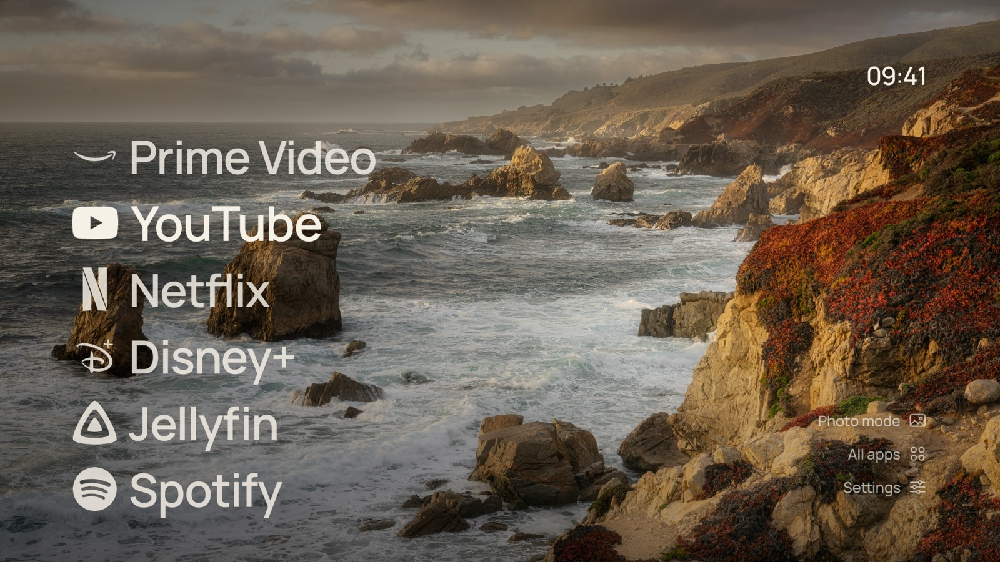
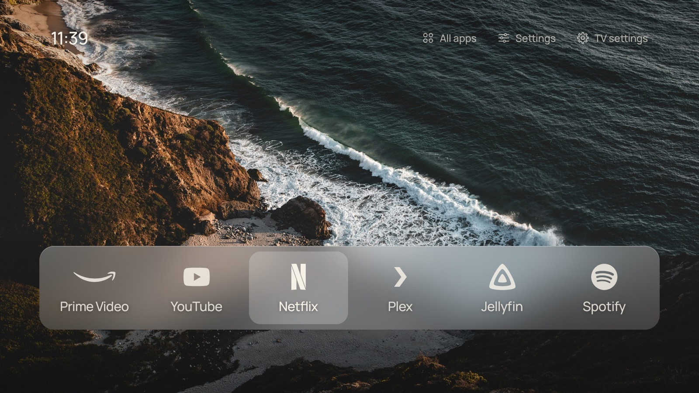
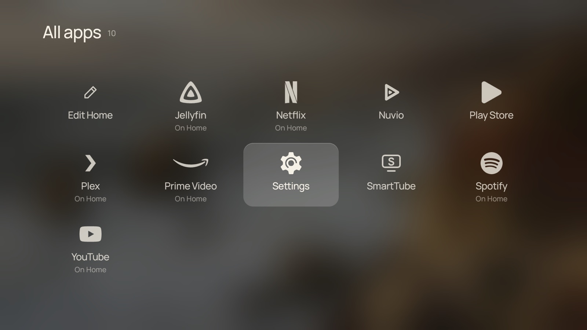
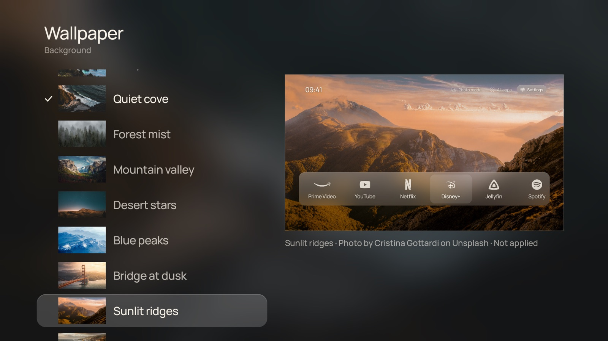
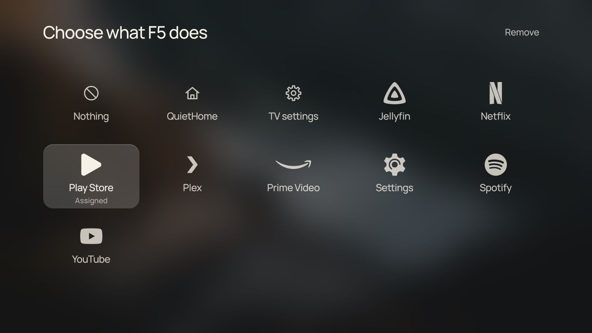

# QuietHome

A quiet home screen for Android TV and Google TV. It shows your apps, your HDMI inputs, a photograph and the time. It is made for the TV remote.

QuietHome is inspired by [CleanFrame](https://github.com/nthnclrk/CleanFrame), a quiet home screen for Samsung The Frame. It uses only native Android views. It has no WebView, no libraries and no network access, so it uses little memory and stays smooth on slow TVs.



<table align=center><tr><td align=center>
<strong>If you find my work valuable, please consider sponsoring</strong><br />
<a href="https://github.com/sponsors/fballiano" target=_blank title="Sponsor me on GitHub"></a>
<a href="https://www.buymeacoffee.com/fballiano" target=_blank title="Buy me a coffee"></a>
<a href="https://www.paypal.com/paypalme/fabrizioballiano" target=_blank title="Donate via PayPal"></a>
</td></tr></table>

## What it does

- **List or Dock layout.** Show names, icons or both. Show a 24-hour or 12-hour clock.
- **One-colour icons.** Known services use a built-in mark. For every other app, QuietHome turns the app's own icon into a mark in the same colour.
- **Backgrounds.** Choose one of 15 photographs, a light colour or a dark colour. Photos can rotate each time Home opens, or every 5, 15 or 60 minutes.
- **Two settings buttons.** Settings (the sliders) opens QuietHome's settings. TV settings (the gear) opens Android's own settings.
- **All apps.** It shows every TV app and every HDMI input. OK opens the item. Hold OK to close an app and free its memory. The first tile, **Edit Home**, opens the Apps on Home editor.
- **Your own order.** Hold OK on an app on Home for a short menu: **Move**, **Remove from Home** or **Close app**. In move mode the arrows move the app, OK places it and Back cancels. Settings → Apps on Home adds apps, with up to nine on Home.
- **Typography and focus.** Choose Manrope, Geist or Newsreader. Choose Type focus or Glass focus, with a Soft, Frost or Clear material.
- **The QuietHome service.** An accessibility service that gives QuietHome the features below. If it is off, QuietHome shows how to turn it on.
  - **Home button.** Home always opens QuietHome, also on TVs that keep their own launcher (for example Google TV). When the stock launcher comes back by itself, for example after the TV wakes from standby, QuietHome replaces it at once. Settings → Android TV → Previous launcher still lets you visit it.
  - **Button mapping.** Press a remote button, for example the Netflix key, and choose what it does: open an app or an HDMI input, open QuietHome or TV settings, or nothing. You do not need a separate button mapper app.
  - **When the TV turns on.** For a TV that only shows a box (for example an Nvidia Shield) on one HDMI port: QuietHome opens that input at boot and each time the TV wakes. It can also open an app. Home still shows QuietHome.
- **No network.** QuietHome has no INTERNET permission. It has no accounts, no analytics and no ads.



| All apps | Settings, with a live preview |
| --- | --- |
|  |  |

## Compatibility

QuietHome runs on Android TV and Google TV 8.0 (API 26) and newer, which includes Android TV 12 and newer. It has no code for one TV brand.

| Tested on (emulators, 1080p) | Result |
| --- | --- |
| Android TV 12 (API 31) | All screens, button mapping, Home button, hold to close, move mode, opening an app at boot and on wake, the service setup screen and its self-repair |
| Google TV 14 (API 34) | All screens, button mapping, Home button, hold to close |

It has not been tested on a real TV yet. Reports are welcome.

## Memory and speed

QuietHome draws everything in one custom view. It decodes one photo at screen size and keeps a 120 × 68 blurred copy for the glass effect. It does not blur live. It draws frames only while something moves. Text that scales with focus has no blurred shadow, because a shadow must be drawn again at each step of the scale.

Measured on a Xiaomi Google TV box (MiTV-AFMU0, Google TV 14, 1080p interface on a 4K output). Each memory figure is the PSS about 15 seconds after the app restarts, from five samples.

| Measurement | Result |
| --- | --- |
| An empty app: only a window, no code | about 20 MB |
| QuietHome, flat background | about 31 MB |
| QuietHome, photo background | about 41 MB |
| The Google TV launcher, in front | about 115 MB |
| QuietHome cold start | 420 to 445 ms |
| QuietHome frame time while focus moves | median 13 ms, 90th percentile 16 ms |

On a real device, the graphics driver runs inside each app that draws, and the graphics chip uses the normal RAM. That is why an empty app already uses about 20 MB. The photo adds about 10 MB: the photo itself in graphics memory, and the driver's work to draw it. A new app is a few MB larger until Android compiles it in the background.

The emulator does not count graphics memory, so it shows lower numbers:

| Android TV 12 emulator, host GPU, 1080p | Result |
| --- | --- |
| QuietHome, photo background | about 29 MB |
| QuietHome, flat background | about 25 MB |
| The stock Android TV launcher, in front | about 45 MB |
| QuietHome frame time while focus moves (median) | about 5 ms, no janky frames |
| QuietHome cold start | about 230 ms |

Measure on your own TV with `adb shell dumpsys meminfo io.github.fballiano.quiethome`.

QuietHome keeps the photo while another app is in front, so Home comes back at once, with no new decode.

## Install with the remote only

You need no computer for this. It works on Android TV and Google TV.

1. Install **Downloader** by AFTVnews from the Play Store on the TV.
2. Open Downloader. Allow it to install apps when the TV asks. If the TV does not ask, go to Settings → Apps → Security & restrictions → Unknown sources (the path changes a little between TVs) and turn on Downloader.
3. In Downloader's address field, type the code **9591315**, then select **Go**. The code always gives the latest release. If the code does not work, type this address instead:

   ```text
   github.com/fballiano/quiethome/releases/latest/download/quiethome.apk
   ```

4. Select **Install** when Downloader has the file, then **Open**.
5. QuietHome shows how to turn on its service. Select **Open Accessibility settings**, then **QuietHome**, and turn it on. If it is grey or says "Restricted setting", go back, select **App info**, allow restricted settings, and try again.

Press Home: QuietHome opens. Later, install a new version the same way; your settings stay. Settings shows the installed version under its title.

## Install with a coding agent

Open this repository in a coding agent with shell access, such as Claude Code or Codex. Turn on developer options on the TV (see below). Then ask:

```text
Install QuietHome on my TV at 192.168.1.50.
```

The agent follows [the install skill](.claude/skills/install-quiethome/SKILL.md). It connects over ADB, checks that the TV is supported, builds and installs the APK, and makes QuietHome the home screen. If the TV keeps its own launcher, it turns on the Home button option. Then it asks how you want Home to look. It records the TV's state first and gives you the commands to go back. You only press OK on the remote when the TV asks.

You can also ask it to change the configuration later, or to remove QuietHome.

## Install

Download `quiethome.apk` from the [latest release](https://github.com/fballiano/quiethome/releases/latest), or build it (see below).

You need a computer with [ADB](https://developer.android.com/tools/adb) and debugging enabled on the TV. To enable it, go to Settings → System (or Device Preferences) → About. Select Build seven times. Then turn on Developer options → USB debugging.

```sh
curl -fLO https://github.com/fballiano/quiethome/releases/latest/download/quiethome.apk
adb connect <tv-address>:5555
adb install -r quiethome.apk
adb shell cmd role add-role-holder --user 0 android.app.role.HOME io.github.fballiano.quiethome
adb shell cmd package set-home-activity io.github.fballiano.quiethome/.Home
adb shell pm grant io.github.fballiano.quiethome android.permission.WRITE_SECURE_SETTINGS
adb shell input keyevent KEYCODE_HOME
```

Release APKs are all signed with the same key, so a new release installs over an older one and keeps your settings. An APK that you build yourself has a different key: to change between the two, uninstall QuietHome first.

Before you install, write down the name of your current launcher:

```sh
adb shell cmd package resolve-activity --brief -a android.intent.action.MAIN -c android.intent.category.HOME
```

### The QuietHome service

The `pm grant` command above lets QuietHome turn its service on by itself. Then QuietHome keeps it on, also after a force stop, which makes Android turn accessibility services off.

Without that command, QuietHome shows a setup screen when its service is off. Select **Open Accessibility settings**, select **QuietHome** and turn it on. On some TVs, the path is Settings → System → Accessibility → QuietHome.

On most Android TV and Google TV devices, the stock launcher is a system app with a higher priority, so it keeps the Home button. The QuietHome service takes the Home button back, without disabling system apps. Long presses of Home do not reach the TV while it does this. To give Home back to Android, choose Settings → Android TV → Home button → **Android**.

### Going back

- On the TV, open Settings → Android TV → Previous launcher.
- In Settings → Android TV → Home button, choose **Android**.
- To stop the self-repair of the service: `adb shell pm revoke io.github.fballiano.quiethome android.permission.WRITE_SECURE_SETTINGS`.
- From a computer, make your previous launcher the home screen again:

  ```sh
  adb shell cmd package set-home-activity <previous-launcher-activity>
  ```

- Uninstall QuietHome: `adb uninstall io.github.fballiano.quiethome`.

## Button mapping

1. Go to Settings → Button mapping. The QuietHome service must be on.
2. Select **Add a button**. Press the remote button, then choose what it does.
3. To change a mapping, select the button in the list. To remove it, choose **Default**: the button then does its own job again.



You cannot map these keys: arrows, OK, Back, Home, volume, mute and power. They always keep their usual job.

Android lets an accessibility service see key presses. QuietHome acts only on Home and on the buttons that you map. All other keys pass through. The service also gets one event, "window changed", which gives the package name of the app in front. QuietHome uses it only to see when the stock launcher's home screen comes back. The service cannot read the screen, and it stores and sends nothing.

## When the TV turns on

Go to Settings → Android TV → When the TV turns on, and choose the HDMI input of your box (or an app). QuietHome opens it at boot and each time the TV wakes from standby. At boot the TV can list its inputs a few seconds late, so QuietHome tries again for about 30 seconds. To show Home again at start, choose **Show Home**, the first tile in the same screen. With Show Home, QuietHome opens itself at boot, so it is the first screen even on a TV whose stock launcher has a higher priority. Press Home on the remote to reach QuietHome at any time.

This needs the QuietHome service: Android lets an app open another screen from the background only with a service like this.

## Configure from a computer

You can set preferences with ADB. QuietHome applies them at once when it is running. Put the whole command in double quotes. If you do not, the TV's shell changes the JSON.

```sh
adb shell "am broadcast -n io.github.fballiano.quiethome/.Config --es config '{
  \"layout\": \"dock\", \"bg\": \"photo\", \"wallpaper\": \"peaks\", \"clock\": \"24\",
  \"home\": [\"com.netflix.ninja\", \"com.google.android.youtube.tv\", \"hdmi:HW5\"],
  \"inputNames\": {\"hdmi:HW5\": \"Nintendo Switch\"},
  \"buttons\": {\"191\": \"com.netflix.ninja\", \"183\": \"action.none\"}
}'"
```

| Key | Values |
| --- | --- |
| `layout` | `list`, `dock` |
| `bg` | `photo`, `light`, `dark` |
| `wallpaper` | `misty`, `cove`, `forest`, `valley`, `night`, `peaks`, `bridge`, `ridge`, `golden`, `summit`, `goldcoast`, `sydney`, `amber`, `mint`, `alpine` |
| `rotation` | `fixed`, `open`, `5`, `15`, `60` |
| `clock` | `24`, `12` |
| `font` | `manrope`, `geist`, `newsreader` |
| `focus` | `type`, `glass` |
| `material` | `soft`, `frost`, `clear` |
| `apps`, `controls` | `both`, `text`, `icons` |
| `homeKey` | `quiethome`, `system` |
| `startOn` | A package name or HDMI input id to open when the TV turns on; `""` shows Home |
| `home` | A list of up to nine package names or input ids |
| `inputNames` | Input id to name. An empty name restores the TV's name. |
| `buttons` | Android keycode to a package name, an input id, `action.none`, `action.home` or `action.settings`. An empty value removes the mapping. |

HDMI input ids look like `hdmi:HW5`. To see them, send an empty configuration (`--es config '{}'`), then run `adb logcat -d -s QuietHome | grep 'HDMI input'`.

To map a remote button, the easiest way is on the TV: Settings → Button mapping → Add a button. The `buttons` key needs the Android keycode, which the TV's key layout decides.

## Build from source

You need a JDK (17 or newer) and the Android SDK with a platform (34 or newer) and build-tools. Gradle is not necessary.

```sh
sh build.sh
```

The script writes `out/quiethome.apk`. The first build creates a local test key, `key.jks`. Keep this file: an update installs over an earlier build only with the same key. To use your own key, set `KEYSTORE` and `KEYSTORE_PASS`.

GitHub Actions ([`.github/workflows/build.yml`](.github/workflows/build.yml)) runs the same script on every push and pull request, and keeps the APK as a build artifact. To publish a release, push a version tag:

```sh
git tag v0.2.0
git push origin v0.2.0
```

The workflow then builds the APK with that version, signs it with the release key from the repository secrets `KEYSTORE_BASE64` and `KEYSTORE_PASS`, and publishes it as a GitHub Release. Releases are immutable, and each APK has a build provenance attestation. To check that GitHub built an APK from this repository:

```sh
gh attestation verify quiethome.apk --repo fballiano/quiethome
```

[SECURITY.md](SECURITY.md) tells how to report a security problem, what rights the app has, and how releases are made and protected.

| Location | Contents |
| --- | --- |
| `src/` | The Java source: one activity (`Home`), one view (`Stage`) and one class for each screen |
| `res/` | Strings, the theme, the icon and the vector marks |
| `assets/` | The photographs and the fonts |
| `tools/` | The source SVG marks and `svg2vector.py`, which converts them to vector drawables |
| `build.sh` | The build: aapt2, javac, d8, zipalign and apksigner |
| `.github/workflows/` | The build on GitHub, and the releases |

## Support QuietHome

QuietHome is free and has no ads. If it makes your TV better, you can support its work through [GitHub Sponsors](https://github.com/sponsors/fballiano), [Buy Me a Coffee](https://buymeacoffee.com/fballiano) or [PayPal](https://paypal.me/fabrizioballiano).

## Licence

Copyright (C) 2026 Fabrizio Balliano.

QuietHome is free software under the [GNU General Public License, version 3 or any later version](LICENSE) (GPL-3.0-or-later). You can share and change it. If you share it, changed or not, you must also make its source available under the same licence. QuietHome comes with no warranty.

Fonts, photographs and brand marks keep their own terms. See [THIRD_PARTY_NOTICES.md](THIRD_PARTY_NOTICES.md).

QuietHome is an independent project. It has no affiliation with Google or any streaming service. Brand marks identify the services that own them.
